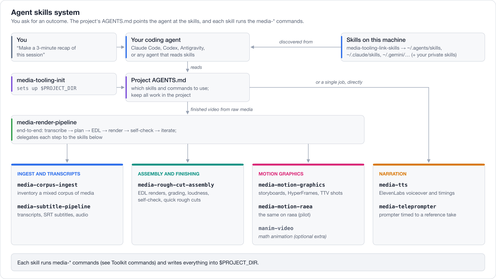

# Agent skills

media-tooling is used through prompts. You describe the outcome you want, and your coding agent uses the
toolkit's skills to choose and run the commands. This page explains how that routing works and what each skill
covers.

## Three layers

1. **Project `AGENTS.md`.** `media-tooling-init` writes a managed block into the project workspace's `AGENTS.md`.
   It lists the installed skills and commands, and keeps all work inside `$PROJECT_DIR`. Re-running the command
   refreshes only that block. The block's source is
   [`src/media_tooling/templates/project_AGENTS.md`](../src/media_tooling/templates/project_AGENTS.md).
2. **Skills.** Each skill is a `SKILL.md` under [`.agents/skills/`](../.agents/skills/) saying when to use it and
   which steps and commands to run. `media-tooling-link-skills` links them into `~/.agents/skills` (Codex and
   other agents), `~/.claude/skills` (Claude Code) and Antigravity's `~/.gemini/` skill folders. Re-run it after
   every upgrade, because the link targets move when the tool environment is rebuilt.
3. **Commands.** The skills run the `media-*` commands listed in [COMMANDS.md](COMMANDS.md). They write their
   outputs into the project workspace and never modify source media.

Private skills in your local config folder (`~/.config/media-tooling/skills/` by default) are linked the same
way, so your own workflows reach every agent without living in this public repository. See
[LOCAL-CONFIG.md](LOCAL-CONFIG.md).

## The media skills

| Skill | Use it for |
| --- | --- |
| [`media-render-pipeline`](../.agents/skills/media-render-pipeline/SKILL.md) | A finished video from raw media, end to end: transcribe, pack, plan, EDL, render, self-check, iterate. It delegates steps to the skills below. |
| [`media-corpus-ingest`](../.agents/skills/media-corpus-ingest/SKILL.md) | A new corpus of mixed media: inventories, transcripts, contact sheets, indexed stills and analysis notes. |
| [`media-subtitle-pipeline`](../.agents/skills/media-subtitle-pipeline/SKILL.md) | Transcripts, SRT subtitles, extracted audio and transcript metadata, for one file or a batch. |
| [`media-rough-cut-assembly`](../.agents/skills/media-rough-cut-assembly/SKILL.md) | EDL renders with grading, fades, loudness and self-checks, plus quick card, image and clip rough cuts. |
| [`media-motion-graphics`](../.agents/skills/media-motion-graphics/SKILL.md) | Narrated explainers, product videos, motion graphics and overlays with HyperFrames and optional TTV footage: storyboards, director notes, visual review. |
| [`media-motion-raea`](../.agents/skills/media-motion-raea/SKILL.md) | Pilot: the same kind of standalone video as raea React compositions. Used only when you ask for raea. See [RAEA.md](RAEA.md). |
| [`media-tts`](../.agents/skills/media-tts/SKILL.md) | Narration and voiceover with ElevenLabs, as one file or per-frame clips with word timings. |
| [`media-teleprompter`](../.agents/skills/media-teleprompter/SKILL.md) | A karaoke teleprompter page timed to a reference take, for recording a script to camera. |
| [`manim-video`](../.agents/skills/manim-video/SKILL.md) | Optional: mathematical and technical animation with Manim (`media-tooling[animations]`). It isn't linked by `media-tooling-link-skills`. |

`media-render-pipeline` is the entry point for "make me a finished video". For a single job, such as
transcribing a folder or voicing a script, the agent goes straight to the skill that covers it.

## Development skills

The other folders under `.agents/skills/` (`commit`, `push`, `pull`, `land`, `linear`, `convert-tasks-to-linear`,
`create-implementation-plan`, `opensymphony-memory`) support developing this repository through OpenSymphony.
They aren't part of the media skill system: `media-tooling-link-skills` doesn't link them, and project workspaces
never see them.
